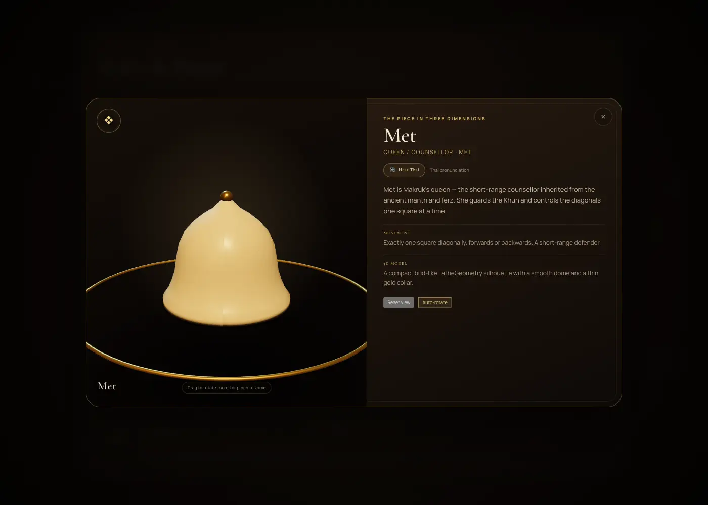
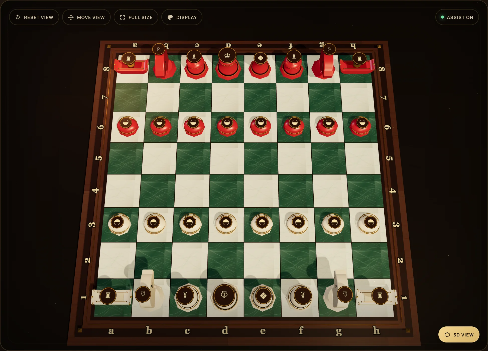
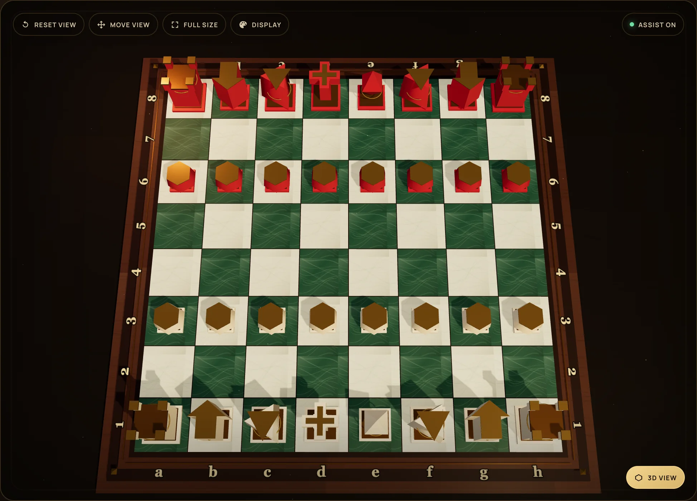

# Makruk 3D — Thai Chess Academy & Beginner Studio

**หมากรุกไทย 3 มิติ · สถาบันหมากรุกไทยและสตูดิโอผู้เริ่มต้น**

**Live demo:** <https://somphol.github.io/makruk-3d/>

An interactive, bilingual 3D Makruk (Thai chess) academy built with vanilla HTML5, CSS3, ES6 JavaScript, and Three.js. It pairs two procedural piece families with a high-contrast carved board, beginner move coaching, a four-level heuristic AI with an adjustable thinking budget, local pass-and-play, synthesized Web Audio sound, and portable JSON match saves.

[](https://somphol.github.io/makruk-3d/)

## Highlights

- **Authentic Makruk rules** — pawns begin on the third/sixth ranks, no double-step, no en passant, no castling, Met moves one diagonal, Khon moves one diagonal or one forward, and promotion happens on the sixth rank.
- **Procedural 3D pieces in four families** — Court uses carved `LatheGeometry` profiles; Tournament exaggerates every officer; **Sigil** tops each piece with a dark seal and a gold glyph for top-down reading; **Monolith** gives each piece a different geometric top face. All are generated from native Three.js primitives with no model files.
- **Top view** — a stage button tilts to a near-overhead camera so the Sigil glyphs and Monolith top faces are immediately readable; toggle back to the 3D view without losing your orbit position.
- **Two opponent finishes** — the default **Ivory & Ruby** pair keeps the opponent vivid against every square; **Ivory & Ebony** is available for the classic look.
- **High-contrast 8×8 board** — choose traditional single-tone or modern checkered patterns, with five material finishes. **Jade & Slate** is the default: pale quartz squares against deep green stone, with Maple & Slate, teak, Carrara/Marquina marble and travertine/granite alternatives. Inlaid gold trim, corner studs, coordinate labels, soft shadows, gold dust, and OrbitControls included.
- **Four bot strengths with adjustable thinking time** — Simple, Medium, Hard and Super Super Hard share one search engine; each starts at its own time preset (0.5 s to 12 s) and the 0.5–20 s slider lets you dial the thinking budget up or down. Hard is the default at 5 s.
- **A bot that converts** — repetition-aware root search, king-and-rook mop-up evaluation, full-window root scoring and deterministic tie-breaking stop the engine from shuffling when it is ahead.
- **Full-size board mode** — hides the side panels and header so the board can fill the viewport; exit with the same button or Escape.
- **Honed, anti-glare board** — every board finish uses matte stone or low-sheen wood so the key light cannot wash out a square.
- **Beginner Move Assist** — green glowing dots for legal destinations and red pulse rings for captures.
- **Interactive tutor** — displays the selected piece's English and Thai names, phonetic pronunciation, movement summary, legal move count, and capture count.
- **Illustrated glossary** — seven clickable piece cards with lore, movement, pronunciation, and 3D modeling notes, plus a Makruk-in-60-seconds rule sheet.
- **Interactive 3D piece preview** — click any Rules & Pieces card, or the **View in 3D** link inside the tutor bar, to open a separate orbit-controlled model with auto-rotate, reset view, and Thai pronunciation buttons.
- **Thai pronunciation** — every piece card and preview panel plays a bundled Thai recording (macOS **Kanya** voice) for ขุน, เม็ด, โคน, ม้า, เรือ, เบี้ย and เบี้ยหงาย, with browser speech synthesis as a fallback. Repeated clicks restart the clip reliably and respect the sound toggle.
- **Stalemate review** — after a stalemate, a beginner panel shows the final move, the safe Khun, and every escape square alongside the piece controlling it.
- **Single Player vs AI or Pass & Play** — a heuristic alpha-beta bot playing Black with four strengths and an adjustable thinking budget, or two humans sharing one board.
- **Instant EN ⇄ TH switching** — all headers, labels, tooltips, tutor copy, move record, result overlay, display settings, and glossary update without interrupting a match.
- **Side-aware labels** — in Single Player the second side is called **Opponent**, not Black; its turn stone, move dots and capture labels follow the ruby finish. Pass & Play names the side **Ruby** or **Black** to match the selected finish.
- **Replay the last move** — a **Replay** button in the Match Record re-animates the opponent's last move (including captures) without changing the position, so a long think cannot make you miss it.
- **Replay the whole game** — **Replay game** rebuilds the match from the initial position and animates every stored move, with play/pause, previous/next and exit controls. The live position is restored exactly when you leave.
- **Readable coordinates** — file and rank labels are large, outlined and repeated on all four edges of the board.
- **Live camera while the bot thinks** — the search yields to the browser every ~70 ms, so you can still orbit and zoom the board during a long think.
- **Display controls on the board** — a **Display** button in the stage toolbar opens theme, piece, opponent-colour and text-size settings, so the customisation is not buried in the sidebar.
- **Four display themes & scalable text** — Midnight Lacquer, Ivory Court, Jade Pavilion, and Ruby Palace, plus four text sizes from 90% to 140%. Preferences are saved on the device.
- **Adjustable stage palette** — choose the coloured room/backdrop behind the board from six presets or any custom colour. Light stages soften the vignette and table automatically.
- **Moveable board view** — orbit, zoom, right-drag to pan, or switch on **Move view** to reposition the board with an ordinary drag. Reset view recentres everything.
- **Web Audio synthesis** — wooden piece thuds, capture clacks, check alerts, promotion chimes, victory fanfare, defeat cadence, and draw chords. No audio files.
- **Persistence** — autosaves to `localStorage`, downloads `makruk_save.json`, and restores matches from JSON.
- **Responsive** — desktop, tablet, and mobile layouts, with camera framing adjusted for portrait screens.
- **Accessible** — keyboard-focusable controls, modal focus trapping, Escape to close, ARIA labels, live regions, and reduced-motion support.

## Run locally

The app is static but uses ES modules and CDN imports, so serve it over HTTP:

```bash
cd makruk-3d
python3 -m http.server 8080
```

Open <http://localhost:8080>.

You can use any static server:

```bash
npx serve .
```

> An internet connection is required for the Three.js module and Google Fonts CDN. There is no build step and no package installation.

## How to play

1. Choose **Single Player** to command White against the academy bot, or **Pass & Play** for two local players. In Single Player, pick **Simple**, **Medium**, **Hard** or **Super Super Hard**, then set the **Thinking time** slider (0.5–20 s).
2. Click a piece. With **Beginner Move Assist** enabled, green dots show legal moves and red rings show captures.
3. Click a highlighted destination to move. Captures, checks, promotions, and the match result are announced in the tutor bar, move record, and sound design.
4. Use **Save Match** to download `makruk_save.json`; use **Load Match** to restore a saved position.
5. Switch **EN / TH** at any time without resetting the match.
6. Open **Display** in the board toolbar (or **Theme, pieces & text** in the sidebar) to choose a display theme, a board pattern, a board material, a piece set, an opponent colour, a stage colour, and a larger type size.
7. Use **Move view** to drag the board to a new position, or right-drag/two-finger drag at any time. **Reset view** recentres it.
8. Use **Full size** to expand the board into an immersive viewport. Press the button again or Escape to return.

> **Board note:** Traditional Thai Makruk boards are usually single-tone with carved grid lines; modern Thai club boards often alternate light and dark squares. The academy supports both, with the checkered pattern enabled by default.
>
> Sources: [Makruk Game Indy — Thai boards are commonly single-tone or may alternate colours](https://makruk.gameindy.com/manual/lets-get-to-know-basics-of-playing-thai-chess), [PlayBoardGames — traditional boards are not chequered](https://playboardgames.org/how-to-play/makruk).

### Piece preview & Thai pronunciation



Open **Rules & Pieces** and click any card, or select a piece on the board and use **View in 3D** in the tutor bar, to explore its procedural 3D model. Drag to orbit, scroll or pinch to zoom, toggle auto-rotate, or reset the view. The speaker button on each card and in the preview panel plays a bundled Thai pronunciation recording; repeated clicks restart the clip immediately. If the recording cannot load, the browser's Thai speech voice is used as a fallback. The preview also shows the role, movement and hand-built modeling notes.

### Board finishes

| Finish | Character |
| --- | --- |
| Jade & Slate | Pale quartz against deep green stone — the default, and the most distinctive board. |
| Maple & Slate | Pale maple against blue-grey slate — the brightest alternative. |
| Teak & Ebony | Warm carved wood, the original academy board. |
| Carrara & Marquina | Honed white marble against deep black stone. |
| Travertine & Granite | Honed ivory travertine with warm charcoal granite. |

The stone finishes use a low-glare honed treatment and are inspired by publicly sold stone table-top boards, where contrasting natural stones are inlaid flush into the playing surface. Jade & Slate and Maple & Slate follow the same principle: separate the two square values as far as possible so the pieces, not the board, carry the eye. References: [stone chess board styles](http://pebblez.com/stone-chess-boards.html), [marble chess-set buying guide](https://marbleseven.com/marble-chess-set-handcrafted-stone-chess-boards-buying-guide/), [travertine chess tables](https://www.1stdibs.com/furniture/tables/game-tables/1960s-pedestal-travertine-chess-table/id-f_33774512/).

### Piece sets

Open **Theme & text size → Piece set** to switch families at any time; the board, tutor, glossary and 3D preview all follow the choice.

| Set | Design language |
| --- | --- |
| Court | Rounded lathe turnings with flared collars and gold bands, closest to a ceremonial Thai set. |
| Tournament | Blocky, high-silhouette pieces: a five-point crown for the Khun, a faceted diamond for the Met, a wide-brimmed helmet for the Khon, an exaggerated horse head for the Ma, a crenellated barge for the Ruea, and a spired shell for the promoted Bia. |
| Sigil | Dark wax-seal caps with a gold glyph on every piece — crown, diamond, mitre, horse, rook, shell and star. The top face is the primary cue; the bodies keep the side profiles distinct. |
| Monolith | Geometric columns with a different top face: cross (Khun), diamond (Met), triangle (Khon), arrow (Ma), crenellated tower (Ruea), hexagon (Bia) and octagon (Bia Ngua). |

| Sigil from above | Monolith from above |
| --- | --- |
|  |  |

The opponent defaults to **Ivory & Ruby** because a near-black piece can vanish into a warm wooden square at a distance. Choose **Ivory & Ebony** in the same panel if you prefer the classic pairing.

### Bot levels and thinking time

| Level | Default thinking time | Character |
| --- | ---: | --- |
| Simple | 0.5 s | Shallow search with deliberate near-best choices. |
| Medium | 1.5 s | A solid club opponent that still misses deep tactics. |
| Hard | 5 s | Quiescence search, full-window root scoring and a winning mop-up term. |
| Super Super Hard | 12 s | The same engine with the deepest budget and no randomness. |

The slider ranges from 0.5 s to 20 s. Choosing a level resets the slider to that level's preset; after that you can dial it freely. A longer budget lets iterative deepening reach further, but the level's search depth, quiescence and blunder policy still apply. The search yields to the browser while it runs, so the board stays orbitable during a long think; the thinking chip names the level and budget.

### Replay

- **Replay** in the Match Record header replays the last move, including a captured-piece ghost, without changing the position.
- **Replay game** in the actions panel rebuilds the match from the opening and animates every stored move. A floating bar provides play/pause, previous, next and exit. Save and Load are disabled while the replay runs.
- On exit, the live board, turn, captures, move record and result status are restored exactly. Replay never overwrites the autosave.

## Camera controls

- Drag to orbit the board.
- Scroll or pinch to zoom.
- **Move view** switches left-drag/touch-drag to panning; right-drag and two-finger drag also pan.
- **Full size** expands the board and hides the surrounding panels.
- **Reset view** recentres the board and returns to the academy's signature three-quarter angle.
- **Top view** tilts to a near-overhead camera for reading the Sigil glyphs and Monolith top faces; press it again to return to your previous 3D view.
- Orbit and zoom stay available while the bot is thinking; the search yields a frame every ~70 ms.

## Authentic Makruk rules implemented

| Piece | Thai | Movement |
| --- | --- | --- |
| Khun | ขุน | One square in any direction; no castling. |
| Met (queen / counsellor) | เม็ด | One square diagonally. |
| Khon | โคน | One square diagonally, or one square straight forward. |
| Ma | ม้า | L-shaped knight leap; only jumping piece. |
| Ruea | เรือ | Any distance orthogonally; cannot jump. |
| Bia | เบี้ย | One square forward; captures one square diagonally forward. No double-step or en passant. |
| Bia Ngua | เบี้ยหงาย | Promoted Bia; moves one square diagonally, like a Met. |

**Met is the Makruk queen/counsellor** — the short-range descendant of the Sanskrit *mantri* and the Persian *ferz*. It is not a pawn or a literal seed; the Thai name is the piece's traditional name, while its role on the board is the queen.

Starting position (White at the bottom):

```text
r n g k f g n r     Black: Ruea, Ma, Khon, Khun, Met, Khon, Ma, Ruea
. . . . . . . .
p p p p p p p p     Black Bia on rank 6
. . . . . . . .
. . . . . . . .
P P P P P P P P     White Bia on rank 3
. . . . . . . .
R N G K F G N R     White: Ruea, Ma, Khon, Khun, Met, Khon, Ma, Ruea
```

The app also detects checkmate, stalemate, threefold repetition, and bare-kings draws. A stalemate opens a **Why is this a draw?** review that highlights the final move, the unchecked Khun, and every covered escape square.

## Project structure

```text
makruk-3d/
├── index.html       # Semantic app shell, bilingual data-i18n hooks, modals
├── style.css        # Midnight-lacquer visual system and responsive layout
├── script.js        # Three.js scene, procedural models, rules, AI, audio, I/O
├── audio/th/        # Bundled Thai pronunciation WAVs (Kanya voice)
├── docs/
│   ├── hero.webp
│   ├── mobile.webp
│   ├── piece-preview.webp
│   ├── ARCHITECTURE.md
│   └── REPRODUCTION.md
├── scripts/
│   └── check.mjs    # Dependency-free release verification
├── README.md
├── AGENTS.md        # Agent handoff and constraints
└── STATE.md         # Build timing, token usage, and session credits
```

## 3D modeling notes

The **Court** set uses rounded lathe profiles; the **Tournament** set shares a stepped eight-sided base but gives every officer a different crown.

| Piece | Court | Tournament |
| --- | --- | --- |
| Khun | A 26-point `LatheGeometry` profile: bell base, tapered waist, flared collar, tiered crown, gold finial. | A tall pagoda body under a five-point gold crown with one taller centre prong. |
| Met | A compact bud profile from `LatheGeometry`, smooth dome, gold collar and finial bead. | A slender stem topped by a vertically stretched octahedron — the only diamond on the board. |
| Khon | A stupa/lotus-bud lathe with stacked gold rings and a tapered spire. | A wide-brimmed warrior helmet: the disc brim separates it from the Ma at a glance. |
| Ma | A hand-drawn `THREE.Shape` horse-head silhouette extruded with bevels, plus layered mane cones, eyes, and a golden cheek disc. | A larger, longer horse head with raised ears, a jagged gold mane, bridle straps and a taller base. |
| Ruea | A custom-extruded longboat hull with sweeping bow and stern, deck rails, cabin ridge, and gold bow eyes. | The same barge hull under a crenellated cabin tower, so it reads as a rook. |
| Bia | A flattened hemisphere cowrie shell on a turned foot, with a gold slit and end beads. | The same shell on the shared stepped plinth with a gold slit. |
| Bia Ngua | The inverted shell marked with a raised golden inlay ring, dark concave centre, and gold bead. | A taller promoted shell with a gold ring, dark centre and a gold spire. |

The board is built from 64 carved tile meshes on a layered plinth. All material grain is generated procedurally with canvas textures; no bitmap assets ship with the app.

## AI

Four levels share one engine: legal-move generation, iterative deepening, alpha-beta pruning, MVV-LVA capture ordering, killer moves, a history heuristic, quiescence search on Hard and Super Super Hard, and a piece-square evaluation with pawn advancement, open files, king safety, enemy-king pressure and an endgame mop-up term. The root is searched with a full window so every candidate has an exact score; ties are broken toward captures, promotions and advancement, with repetition penalties when the bot is ahead. The search budget is the slider value (0.5–20 s), and the level preset supplies the starting budget. The root search yields to the browser roughly every 70 ms, so the render loop and OrbitControls keep working during a deep think; moves and menu actions that would change the position remain blocked. It plays Black only in Single Player mode.

## Save format

`Save Match` downloads a human-readable file:

```json
{
  "format": "makruk-3d-save",
  "version": 1,
  "savedAt": "2026-11-01T19:00:00.000Z",
  "credits": {
    "builtWith": "OpenCode",
    "model": "DeepSeek V4.1 Flash",
    "provider": "opencode-go",
    "modelId": "deepseek-v4.1-flash"
  },
  "game": {
    "board": ["..."],
    "turn": "w",
    "mode": "ai",
    "history": ["..."],
    "positionCounts": {}
  }
}
```

The same payload is auto-saved under `makruk3d.match.v1` in browser storage.

## Credits

- **Built with:** [OpenCode](https://opencode.ai)
- **Model:** DeepSeek V4.1 Flash
- **Provider / model ID:** `opencode-go` / `deepseek-v4.1-flash`
- **Rendering:** [Three.js](https://threejs.org) r160 via CDN, with `OrbitControls`
- **Typography:** Cormorant Garamond, Manrope, Noto Sans Thai, and Noto Serif Thai via Google Fonts
- **Cultural inspiration:** the Thai Makruk tradition, its court pieces, and the Thai river-barge silhouette of the Ruea
- **Contrast and identification direction:** [Full 3D Chess Academy](https://github.com/somphol/full-3d-chess-academy), whose maple-and-slate board and legible piece family informed the 1.8 readability pass
- **Thai pronunciation audio:** generated with the macOS **Kanya** Thai system voice

Build timing and token usage are recorded in [STATE.md](STATE.md).

## Documentation

- [AGENTS.md](AGENTS.md) — agent handoff, commands, architecture and constraints.
- [docs/ARCHITECTURE.md](docs/ARCHITECTURE.md) — module, rules, AI and scene map.
- [docs/REPRODUCTION.md](docs/REPRODUCTION.md) — rebuild and verification book.
- [docs/TESTING.md](docs/TESTING.md) — what was verified and what was not.
- [docs/DEPLOYMENT.md](docs/DEPLOYMENT.md) — Pages runbook.
- [STATE.md](STATE.md) — historical build timing, tokens and session credits.

## License

MIT © 2026 Makruk 3D contributors. See [LICENSE](LICENSE).
