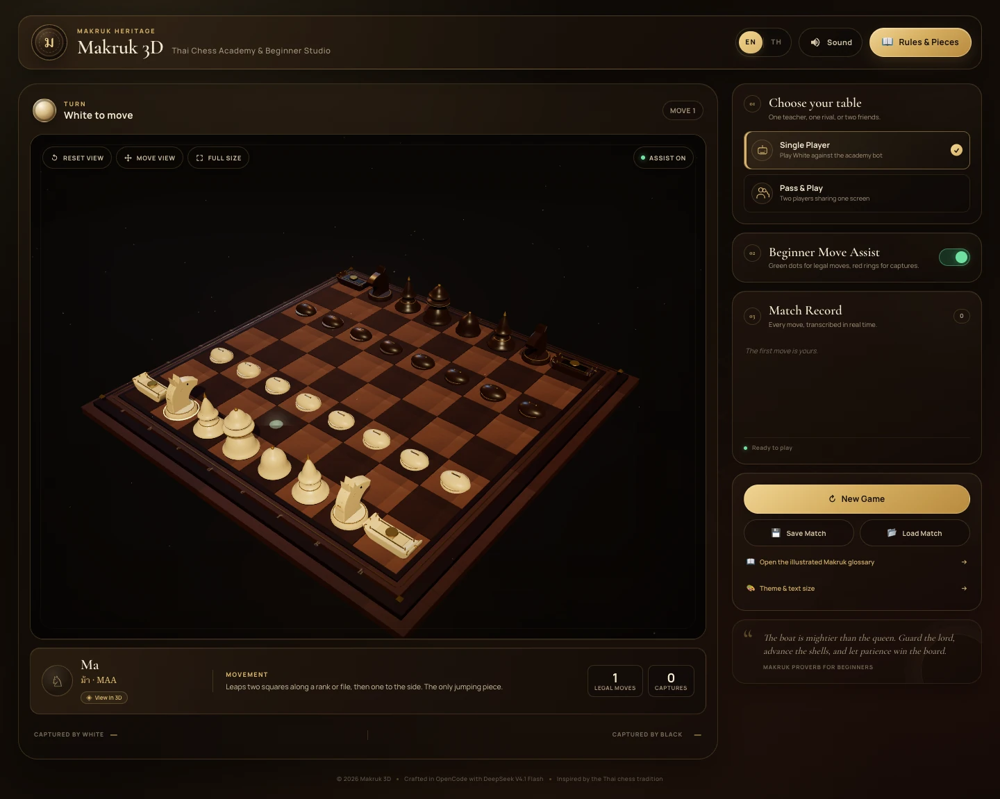

# Makruk 3D — Thai Chess Academy & Beginner Studio

**หมากรุกไทย 3 มิติ · สถาบันหมากรุกไทยและสตูดิโอผู้เริ่มต้น**

**Live demo:** <https://somphol.github.io/makruk-3d/>

An interactive, bilingual 3D Makruk (Thai chess) academy built with vanilla HTML5, CSS3, ES6 JavaScript, and Three.js. It uses authentic procedural piece silhouettes, a carved teak board, beginner move coaching, a heuristic AI opponent, local pass-and-play, synthesized Web Audio sound, and portable JSON match saves.

[](https://somphol.github.io/makruk-3d/)

## Highlights

- **Authentic Makruk rules** — pawns begin on the third/sixth ranks, no double-step, no en passant, no castling, Met moves one diagonal, Khon moves one diagonal or one forward, and promotion happens on the sixth rank.
- **Procedural 3D pieces** — Khun, Met, Khon, Ma, Ruea, Bia, and Bia Ngua are generated from `LatheGeometry`, `ExtrudeGeometry`, spheres, cones, toruses, and custom profiles. No model files required.
- **Carved 8×8 wooden board** — choose traditional single-tone teak or a modern checkered light/dark pattern, with inlaid gold trim, corner studs, coordinate labels, soft shadows, gold dust, and OrbitControls.
- **Beginner Move Assist** — green glowing dots for legal destinations and red pulse rings for captures.
- **Interactive tutor** — displays the selected piece's English and Thai names, phonetic pronunciation, movement summary, legal move count, and capture count.
- **Illustrated glossary** — seven piece cards with lore, movement, pronunciation, and 3D modeling notes, plus a Makruk-in-60-seconds rule sheet.
- **Stalemate review** — after a stalemate, a beginner panel shows the final move, the safe Khun, and every escape square alongside the piece controlling it.
- **Single Player vs AI or Pass & Play** — a heuristic alpha-beta bot playing Black, or two humans sharing one board.
- **Instant EN ⇄ TH switching** — all headers, labels, tooltips, tutor copy, move record, result overlay, display settings, and glossary update without interrupting a match.
- **Four display themes & scalable text** — Midnight Lacquer, Ivory Court, Jade Pavilion, and Ruby Palace, plus four text sizes from 90% to 140%. Preferences are saved on the device.
- **Adjustable stage palette** — choose the coloured room/backdrop behind the board from six presets or any custom colour. Light stages soften the vignette and table automatically.
- **Moveable board view** — orbit, zoom, right-drag to pan, or switch on **Move view** to reposition the board with an ordinary drag. Reset view recentres everything.
- **Web Audio synthesis** — wooden piece thuds, capture clacks, check alerts, promotion chimes, victory fanfare, defeat cadence, and draw chords. No audio files.
- **Persistence** — autosaves to `localStorage`, downloads `makruk_save.json`, and restores matches from JSON.
- **Responsive** — desktop, tablet, and mobile layouts, with camera framing adjusted for portrait screens.
- **Accessible** — keyboard-focusable controls, modal focus trapping, Escape to close, ARIA labels, live regions, and reduced-motion support.

## Run locally

The app is static but uses ES modules and CDN imports, so serve it over HTTP:

```bash
cd makruk-3d
python3 -m http.server 8080
```

Open <http://localhost:8080>.

You can use any static server:

```bash
npx serve .
```

> An internet connection is required for the Three.js module and Google Fonts CDN. There is no build step and no package installation.

## How to play

1. Choose **Single Player** to command White against the academy bot, or **Pass & Play** for two local players.
2. Click a piece. With **Beginner Move Assist** enabled, green dots show legal moves and red rings show captures.
3. Click a highlighted destination to move. Captures, checks, promotions, and the match result are announced in the tutor bar, move record, and sound design.
4. Use **Save Match** to download `makruk_save.json`; use **Load Match** to restore a saved position.
5. Switch **EN / TH** at any time without resetting the match.
6. Open **Theme & text size** to choose a display theme, a traditional or checkered board, a stage colour, and a larger type size.
7. Use **Move view** to drag the board to a new position, or right-drag/two-finger drag at any time. **Reset view** recentres it.

> **Board note:** Traditional Thai Makruk boards are usually single-tone with carved grid lines; modern Thai club boards often alternate light and dark squares. The academy supports both, with the checkered pattern enabled by default.
>
> Sources: [Makruk Game Indy — Thai boards are commonly single-tone or may alternate colours](https://makruk.gameindy.com/manual/lets-get-to-know-basics-of-playing-thai-chess), [PlayBoardGames — traditional boards are not chequered](https://playboardgames.org/how-to-play/makruk).

### Camera controls

- Drag to orbit the board.
- Scroll or pinch to zoom.
- **Move view** switches left-drag/touch-drag to panning; right-drag and two-finger drag also pan.
- **Reset view** recentres the board and returns to the academy's signature three-quarter angle.

## Authentic Makruk rules implemented

| Piece | Thai | Movement |
| --- | --- | --- |
| Khun | ขุน | One square in any direction; no castling. |
| Met | เม็ด | One square diagonally. |
| Khon | โคน | One square diagonally, or one square straight forward. |
| Ma | ม้า | L-shaped knight leap; only jumping piece. |
| Ruea | เรือ | Any distance orthogonally; cannot jump. |
| Bia | เบี้ย | One square forward; captures one square diagonally forward. No double-step or en passant. |
| Bia Ngua | เบี้ยหงาย | Promoted Bia; moves one square diagonally, like a Met. |

Starting position (White at the bottom):

```text
r n g k f g n r     Black: Ruea, Ma, Khon, Khun, Met, Khon, Ma, Ruea
. . . . . . . .
p p p p p p p p     Black Bia on rank 6
. . . . . . . .
. . . . . . . .
P P P P P P P P     White Bia on rank 3
. . . . . . . .
R N G K F G N R     White: Ruea, Ma, Khon, Khun, Met, Khon, Ma, Ruea
```

The app also detects checkmate, stalemate, threefold repetition, and bare-kings draws. A stalemate opens a **Why is this a draw?** review that highlights the final move, the unchecked Khun, and every covered escape square.

## Project structure

```text
makruk-3d/
├── index.html       # Semantic app shell, bilingual data-i18n hooks, modals
├── style.css        # Midnight-lacquer visual system and responsive layout
├── script.js        # Three.js scene, procedural models, rules, AI, audio, I/O
├── docs/
│   ├── hero.webp
│   └── mobile.webp
├── README.md
└── STATE.md         # Build timing, token usage, and session credits
```

## 3D modeling notes

| Piece | Geometry strategy |
| --- | --- |
| Khun | A 26-point `LatheGeometry` profile: bell base, tapered waist, flared collar, tiered crown, gold finial. |
| Met | A compact bud profile from `LatheGeometry`, smooth dome, gold collar and finial bead. |
| Khon | A stupa/lotus-bud lathe with stacked gold rings and a tapered spire. |
| Ma | A hand-drawn `THREE.Shape` horse-head silhouette extruded with bevels, plus layered mane cones, eyes, and a golden cheek disc. |
| Ruea | A custom-extruded longboat hull with sweeping bow and stern, deck rails, cabin ridge, and gold bow eyes. |
| Bia | A flattened hemisphere cowrie shell on a turned foot, with a gold slit and end beads. |
| Bia Ngua | The inverted shell marked with a raised golden inlay ring, dark concave centre, and gold bead. |

The board is built from 64 carved tile meshes on a layered teak plinth. All material grain is generated procedurally with canvas textures; no bitmap assets ship with the app.

## AI

The bot uses a legal-move generator, iterative deepening, alpha-beta pruning, MVV-LVA-style capture ordering, piece-square evaluation, pawn-advance bonuses, king safety, and a search deadline of roughly 620 ms. It plays Black only in Single Player mode.

## Save format

`Save Match` downloads a human-readable file:

```json
{
  "format": "makruk-3d-save",
  "version": 1,
  "savedAt": "2026-11-01T19:00:00.000Z",
  "credits": {
    "builtWith": "OpenCode",
    "model": "DeepSeek V4.1 Flash",
    "provider": "opencode-go",
    "modelId": "deepseek-v4.1-flash"
  },
  "game": {
    "board": ["..."],
    "turn": "w",
    "mode": "ai",
    "history": ["..."],
    "positionCounts": {}
  }
}
```

The same payload is auto-saved under `makruk3d.match.v1` in browser storage.

## Credits

- **Built with:** [OpenCode](https://opencode.ai)
- **Model:** DeepSeek V4.1 Flash
- **Provider / model ID:** `opencode-go` / `deepseek-v4.1-flash`
- **Rendering:** [Three.js](https://threejs.org) r160 via CDN, with `OrbitControls`
- **Typography:** Cormorant Garamond, Manrope, Noto Sans Thai, and Noto Serif Thai via Google Fonts
- **Cultural inspiration:** the Thai Makruk tradition, its court pieces, and the Thai river-barge silhouette of the Ruea

Build timing and token usage are recorded in [STATE.md](STATE.md).

## License

MIT © 2026 Makruk 3D contributors. See [LICENSE](LICENSE).
